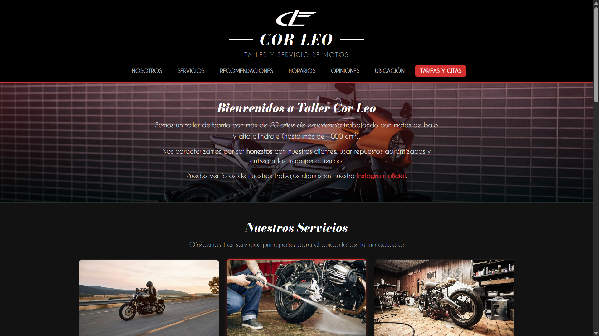
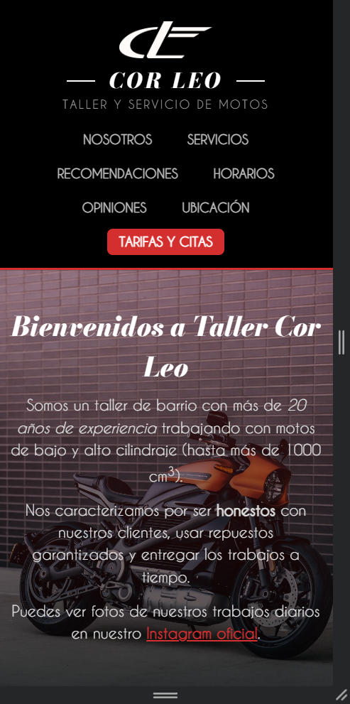

# Proyecto Entregable: Sitio Web de un Negocio Local - Taller Cor Leo

* **Estudiante:** Miguel Ricardo Calderon Serpa
* **Proyecto:** Sitio web para Taller Cor Leo (Taller de Motos)
* **Páginas del sitio:** `index.html` y `contacto.html`
* **Enlace a GitHub:** [https://github.com/mcalderonserpa/SitioWeb-HTML_CSS-CampusLands](https://github.com/mcalderonserpa/SitioWeb-HTML_CSS-CampusLands)
* **Enlace a GitHub Pages:** [https://mcalderonserpa.github.io/SitioWeb-HTML_CSS-CampusLands/](https://mcalderonserpa.github.io/SitioWeb-HTML_CSS-CampusLands/)

---

## 1. El Proyecto

### ¿Qué negocio es?
Para esta actividad elegí **Taller Cor Leo**, un taller de barrio ubicado en Bucaramanga que se dedica a la reparación, mantenimiento preventivo, lavado y venta de repuestos para motocicletas (desde motos pequeñas de 100 cm³ hasta motos de alto cilindraje).

### ¿Para quién es el sitio?
Está dirigido a personas que tienen moto y necesitan:
* Saber qué servicios presta el taller y cuánto cuestan antes de ir.
* Conocer los horarios de atención para no perder el viaje.
* Ver la ubicación exacta en el mapa de Google Maps.
* Agendar una cita por la web sin tener que esperar que le respondan por WhatsApp.

### ¿Qué problema le resuelve al cliente?
El dueño del taller solo atendía por llamadas o WhatsApp y perdía clientes porque no alcanzaba a responder a tiempo ni tenía una lista de precios visible. Con esta página web, cualquier motociclista puede consultar los precios de mantenimiento y lavado desde su celular y pedir una cita llenando un formulario sencillo.

---

## 2. Estructura

### Estructura de carpetas
```text
actividad1/
├── index.html              # Página principal
├── contacto.html           # Segunda página con tablas de tarifas y formulario
├── README.md               # Este documento técnico
├── css/
│   └── style.css           # Hoja de estilos compartida
├── fonts/
│   └── titulos/            # Fuentes locales Bodoni y Caviar Dreams
├── images/                 # Imágenes del taller, logo y servicios
├── capturas/               # Capturas para este documento
└── docs/
    └── Proyecto-Sitio-Negocio-Local.pdf
```

### Etiquetas semánticas
* `<header>`: Agrupar el logo, el título del negocio, el subtítulo y el menú de navegación.
* `<nav>`: Barra de navegación con enlaces a las secciones y a la otra página.
* `<main>`: Encerrar todo el contenido principal de cada página.
* `<section>`: Separar los temas de la página (nosotros, servicios, horarios, opiniones, ubicación y formulario).
* `<article>`: Cada una de las 3 tarjetas de servicio (`.tarjeta`). Se usa article porque cada servicio es una tarjeta con contenido independiente (foto, título, descripción y precio).
* `<aside>`: Recuadro de aviso de emergencias por si alguien se queda varado en moto.
* `<footer>`: Pie de página con el copyright y el enlace de volver arriba.
* `<h1>`: **Un solo h1 por página** (`COR LEO`) para respetar la jerarquía de títulos.

---

## 3. Sistema Visual

En el archivo `css/style.css` se definen variables en `:root` para no repetir valores:

```css
:root {
    --color-fondo: #121212;
    --color-tarjeta: #1e1e1e;
    --color-texto: #e0e0e0;
    --color-blanco: #ffffff;
    --color-rojo: #d32f2f;
    --color-rojo-oscuro: #9a0007;

    /* Escala de grises sólida para las tablas */
    --color-tabla-encabezado: #262626;
    --color-tabla-fila-impar: #1f1f1f;
    --color-tabla-fila-par: #161616;
    --color-tabla-hover: #333333;

    /* Colores con canal alfa (rgba) */
    --color-alfa-negro: rgba(0, 0, 0, 0.75);
    --color-alfa-rojo: rgba(211, 47, 47, 0.3);

    /* Gradiente */
    --gradiente-rojo: linear-gradient(to right, #d32f2f, #9a0007);

    /* Tipografías con respaldo */
    --fuente-titulos: 'bodoni', 'Georgia', serif;
    --fuente-texto: 'caviar', 'Arial', sans-serif;

    /* Medidas */
    --ancho-maximo: 1100px;
    --radio-borde: 6px;
}
```

* **Colores:** fondo oscuro (`#121212`) porque es el color típico de talleres mecánicos y resalta el color rojo (`#d32f2f`) en los botones y detalles.
* **Canal alfa y Gradientes:** `rgba(0, 0, 0, 0.75)` y `rgba(211, 47, 47, 0.3)` con linear-gradient para oscurecer la foto del taller en la sección de bienvenida y que el texto blanco se pueda leer fácilmente. En los botones usé un gradiente `linear-gradient(to right, #d32f2f, #9a0007)`.
* **Fondo con imagen:** En la sección `.seccion--nosotros` combiné la imagen `images/taller-fondo.jpg` con el gradiente oscuro encima (`background-image: linear-gradient(...), url(...)`).
* **Tipografías:** Usé Bodoni para los títulos grandes y Caviar Dreams para el texto general con respaldos estándar como Georgia y Arial.

---

## 4. Especificidad (3 Conflictos Reales)

No se usó `!important`. Los conflictos se resolvieron usando especificidad y orden de aparición.

### Conflicto 1: Color del precio en la tarjeta destacada
* **Elemento:** El párrafo `<p class="tarjeta__precio">` dentro de la tarjeta de lavado (`.tarjeta--destacada`).
* **Reglas que compiten:**
  1. `.tarjeta p` $\rightarrow$ Especificidad: **(0, 1, 1)** (1 clase, 1 etiqueta) $\rightarrow$ `color: #bbbbbb;`
  2. `.tarjeta--destacada .tarjeta__precio` $\rightarrow$ Especificidad: **(0, 2, 0)** (2 clases) $\rightarrow$ `color: var(--color-blanco);`
* **Cuál gana y por qué:** Gana `.tarjeta--destacada .tarjeta__precio` porque tiene 2 clases contra 1 clase y 1 etiqueta. En el inspector se ve la regla `.tarjeta p` tachada.
* **Captura:** `capturas/conflicto1-inspector.png`

### Conflicto 2: Color del enlace "Tarifas y Citas" en el menú
* **Elemento:** El enlace `<a class="nav__enlace nav__enlace--destacado">`.
* **Reglas que compiten:**
  1. `.nav__lista a` $\rightarrow$ Especificidad: **(0, 1, 1)** (1 clase, 1 etiqueta) $\rightarrow$ `color: #bbbbbb;`
  2. `.nav__lista .nav__enlace--destacado` $\rightarrow$ Especificidad: **(0, 2, 0)** (2 clases) $\rightarrow$ `color: var(--color-blanco);`
* **Cuál gana y por qué:** Gana `.nav__lista .nav__enlace--destacado` con especificidad (0, 2, 0). La regla `.nav__lista a` pierde y aparece tachada.
* **Captura:** `capturas/conflicto2-inspector.png`

### Conflicto 3: Empate resuelto por orden en el botón del formulario
* **Elemento:** El botón `<button type="submit" class="boton boton--primario boton--formulario">`.
* **Reglas que compiten sobre la propiedad `padding`:**
  1. `.boton--primario` (línea 216) $\rightarrow$ Especificidad: **(0, 1, 0)** $\rightarrow$ `padding: 0.6rem 1.2rem;`
  2. `.boton--formulario` (línea 390) $\rightarrow$ Especificidad: **(0, 1, 0)** $\rightarrow$ `padding: 0.85rem;`
* **Cuál gana y por qué:** Como las dos reglas tienen exactamente la misma especificidad (0, 1, 0), hay un empate. Gana `.boton--formulario` porque está escrita más abajo en el archivo CSS.
* **Captura:** `capturas/conflicto3-inspector.png`

---

## 5. Herencia

1. **Propiedad que SÍ se hereda:** `color` y `font-family`.
   * En `body` se define `color: var(--color-texto);` y `font-family: var(--fuente-texto);`.
   * Se nota en párrafos como los de las opiniones (`.opinion__texto`) o los ítems de las listas (`<li>`), que toman la fuente y el color gris claro sin tener que declararlos de nuevo.
2. **Propiedad que NO se hereda:** `border-left` y `background-color`.
   * En `.bloque-info` se puso `border-left: 4px solid var(--color-rojo);`.
   * Los elementos hijos dentro de esa caja (`<h3>` y `<ol>`) no heredan ese borde rojo ni el fondo gris; el borde solo queda en la caja principal.

---

## 6. Modelo de Cajas

En el reset se puso `box-sizing: border-box` en todo el documento para que el padding y los bordes no aumenten el ancho total de las cajas.

### Cálculo del componente `.bloque-info`:
En pantalla de computador, una columna de información mide **520 px** de ancho disponible:
* **Borde izquierdo:** 4 px
* **Borde derecho:** 0 px
* **Padding:** 1.5rem (24 px a la izquierda + 24 px a la derecha = 48 px)
* **Contenido interior:** 520 px - 48 px - 4 px = **468 px**
* **Ancho total de la caja:** 468 px + 48 px + 4 px = **520 px**

Si tuviera `box-sizing: content-box`, la caja mediría 520 + 48 + 4 = **572 px** y se desbordaría de la pantalla.

### Colapso de márgenes:
Ocurre entre el título `.seccion__titulo` (`margin-bottom: 0.5rem;` o sea 8 px) y la descripción `.seccion__descripcion` (`margin-top: 0;`). Los márgenes verticales no se suman, sino que se solapan y queda solo el espacio de 8 px.

---

## 7. Selectores

### Pseudoclase estructural utilizada: `:nth-child(odd)` y `:nth-child(even)`
Se usó en las tablas para pintar las filas alternadas:
```css
.tabla-horarios tbody tr:nth-child(odd) {
    background-color: var(--color-tabla-fila-impar); /* #1f1f1f */
}

.tabla-horarios tbody tr:nth-child(even) {
    background-color: var(--color-tabla-fila-par);   /* #161616 */
}
```

### ¿Cómo funciona?
* `:nth-child` cuenta **todos los elementos hermanos** que están dentro del mismo padre (`<tbody>`).
* Cuenta en orden: 1, 2, 3, etc.
* A las posiciones impares (1, 3, 5...) les aplica la fórmula $2n+1$ (`odd`) y les pone el gris `#1f1f1f`.
* A las posiciones pares (2, 4, 6...) les aplica la fórmula $2n$ (`even`) y les pone el gris `#161616`.
* A diferencia de `:nth-of-type` (que solo contaría etiquetas del mismo tipo), `:nth-child` cuenta la posición del hijo sin importar qué etiqueta sea.

---

## 8. Responsive

El sitio está adaptado para verse bien desde computadores hasta celulares de **360 px de ancho**.

### ¿Qué cambia con el `@media (max-width: 768px)`?
1. **Tarjetas de servicio:** En computador se muestran las 3 al mismo nivel con `grid-template-columns: repeat(3, 1fr)`. En celular cambian a `grid-template-columns: 1fr` para verse una sobre la otra y que no queden apretadas.
2. **Columnas de información y opiniones:** Pasan de 2 columnas a 1 sola columna.
3. **Tamaños de letra:** El título principal baja de `2.2rem` a `1.6rem` y en pantallas de 360 px a `1.4rem` para que no se salga de la pantalla del celular.
4. **Tablas con scroll táctil:** El contenedor `.tabla-contenedor` tiene `overflow-x: auto` para que en pantallas de 360 px la tabla se pueda deslizar hacia los lados sin romper el ancho de la página.

---

## 9. Problemas y Soluciones

1. **Problema 1: El pie de página (`footer`) quedaba montado encima del contenido.**
   * *Por qué pasaba:* Al inicio se le había puesto `position: absolute; bottom: 0;`. Cuando se agregaron las tarjetas y las tablas, la página se hizo más larga y el footer se quedó flotando a mitad de pantalla.
   * *Cómo se arregló:* Se le quitó la propiedad `position: absolute` y se dejó en el flujo normal con `padding: 1.5rem 0;`.
2. **Problema 2: En celulares de 360 px la tabla de tarifas se salía de la pantalla.**
   * *Por qué pasaba:* La tabla tiene 4 columnas y en una pantalla tan pequeña el texto no cabe en 360 px.
   * *Cómo se arregló:* Se envolvió la tabla en un `div` con la clase `.tabla-contenedor` y se le puso `overflow-x: auto;`. Así la tabla tiene su propia barra de deslizamiento y la página no se descuadra.

---

## 10. Capturas

### Pagina principal - PC

### Pagina principal - Movil

